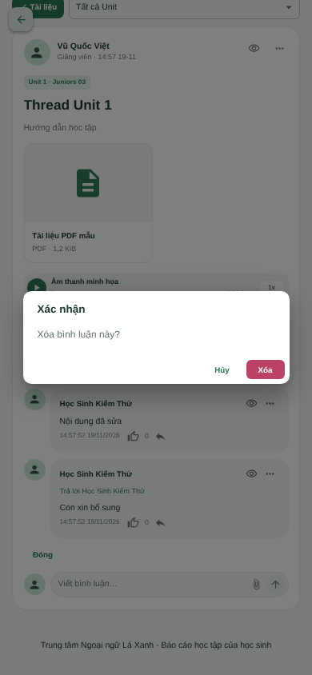
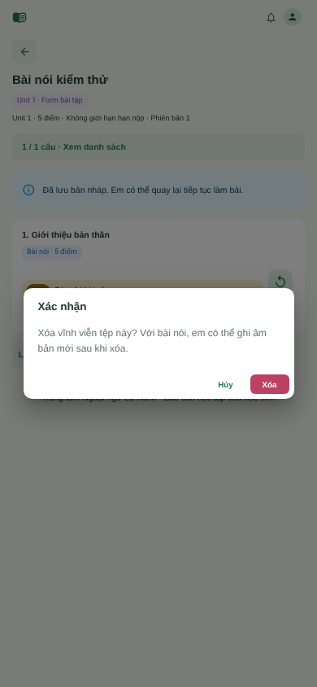

# Hộp thoại xác nhận trong ứng dụng

Student Portal dùng chung cơ chế với Staff Portal: `src/shared/dialogs.tsx` (`askConfirm`, `askText`, `<DialogHost/>` gắn trong `auth/runtime.tsx`) thay cho `window.confirm`. Hộp thoại của trình duyệt bị chặn trong trình duyệt nhúng như Zalo/Facebook (học sinh hay mở link từ đó), khiến thao tác xóa bình luận, tệp, ảnh đại diện hoặc bản ghi âm bị hủy âm thầm.

- Xóa bình luận, tệp bình luận, tệp/bản ghi bài nộp, ảnh đại diện: hộp thoại theo giao diện, nút "Xóa" màu đỏ.
- Cảnh báo rời trang khi chưa lưu (link, nút quay lại, đổi tab, đổi Unit, nút Back trình duyệt) dùng cùng hộp thoại. Đóng/tải lại trang vẫn dùng cảnh báo `beforeunload` của trình duyệt.
- Xóa tệp bài nộp kiểm tra lại trạng thái nộp bài sau khi xác nhận.

Không có timer, polling hay request mới. Không cần đổi backend hoặc cấu hình.

`tests/support/app-dialog.ts` cung cấp `confirmAppDialog`/`cancelAppDialog` cho browser tests.

